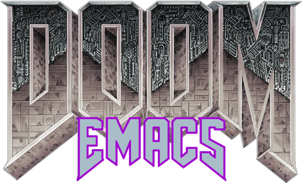

#+title:   My Doom Emacs configuration
#+author: Diego Zamboni
#+author: diego@zzamboni.org

#+attr_html: :width 30%;

See [[file:doom.org][doom.org]] for the source configuration file with full commentary. From this file, three configuration files are generated: [[file:init.el][init.el]], [[file:packages.el][packages.el]] and [[file:config.el][config.el]]. These are the files read by Doom Emacs.

I also made a super simple set of Doom-Emacs custom splash screens, which you can find them in the [[https://gitlab.com/zzamboni/dot-doom/-/tree/master/splash][splash/]] directory.

If you are interested in the topic of literate configuration, you should check out my free book [[https://leanpub.com/lit-config][Literate Configuration]]!

If you have any questions or feedback, feel free to open an issue at https://gitlab.com/zzamboni/dot-emacs/-/issues.

* Cheat sheet launcher

To register the cheat sheet with GNOME, run from this checkout:

The launcher uses the =org.gnome.Evince= Flatpak. Evince reuses an existing
window for the same PDF instead of opening another copy on each click.
=scripts/open-cheatsheet.sh= uses its D-Bus document registry to reuse the
window across Flatpak instances. It requires =gdbus= and =python3=.

#+begin_src sh
./scripts/install-cheatsheet-launcher.sh
#+end_src

The script creates relative symlinks under =${XDG_DATA_HOME:-~/.local/share}=:

- =applications/doom-cheatsheet.desktop= points to the launcher in this repository.
- =icons/hicolor/512x512@2/apps/doom-cheatsheet.png= is a copy of the image in =splash/=. The launcher's =Icon=doom-cheatsheet= resolves through this standard icon-theme directory; no separate registry entry is needed.

It is safe to rerun: the launcher symlink and icon copy are refreshed, and
the GTK icon cache is rebuilt when =gtk-update-icon-cache= is available.
An ordinary file at the launcher destination is preserved. The launch command expects this configuration at =~/.doom.d/=.
After installation, search for /Doom Emacs Cheat Sheet/ in GNOME and pin it to
the dash. If an old icon remains cached, unpin and re-pin it.
